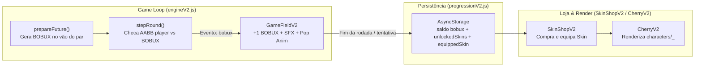

# Planejamento da Feature: Coletável "BOBUX" & Sistema de Skins

## 1. Pesquisa de Referências e Componentes

### 1.1 Estética Visual do "BOBUX" (Inspiração Robux)
O ícone moderno do Robux (Roblox) possui uma geometria icônica de fácil leitura mesmo em tamanhos reduzidos (`24dp`–`32dp`) no mobile:
- **Silhueta Externa:** Hexágono vertical com cantos suavizados e chanfro metálico duplo.
- **Núcleo Interno:** Quadrado vazado com cantos arredondados (aspecto de porca metálica estilizada) acompanhado de linhas laterais horizontais.
- **Paleta Cromática:** Gradiente dourado vibrante (`#FFF2A1` → `#FFD700` → `#E59400`) com contorno escuro de alto contraste (`#6B4200`) para destacar tanto nos biomas claros (*First Bloom*, *Sakura Garden*) quanto nos escuros (*Golden Bloom*, *Yozakura*).

```xml
<!-- Protótipo SVG Nativo (collectibles/bobux_coin) — 64x64 viewBox -->
<svg xmlns="http://www.w3.org/2000/svg" width="64" height="64" viewBox="0 0 64 64">
  <defs>
    <linearGradient id="bobuxGold" x1="0" y1="0" x2="1" y2="1">
      <stop offset="0" stop-color="#FFF3A8"/>
      <stop offset="0.45" stop-color="#FFD026"/>
      <stop offset="1" stop-color="#C87A00"/>
    </linearGradient>
  </defs>
  <!-- Hexágono Externo -->
  <path d="M32 4 L56 17.5 V46.5 L32 60 L8 46.5 V17.5 Z" fill="url(#bobuxGold)" stroke="#5E3700" stroke-width="4" stroke-linejoin="round"/>
  <!-- Chanfro Interno -->
  <path d="M32 10 L50 20.5 V43.5 L32 54 L14 43.5 V20.5 Z" fill="none" stroke="#FFF8C9" stroke-width="2" opacity="0.75"/>
  <!-- Núcleo Quadrado Arredondado Estilo Robux -->
  <rect x="23" y="23" width="18" height="18" rx="5" fill="none" stroke="#5E3700" stroke-width="4"/>
  <rect x="25" y="25" width="14" height="14" rx="3" fill="#FFF3A8" opacity="0.85"/>
</svg>
```

### 1.2 Componentes Prontos vs. Stack Nativa do Projeto
| Abordagem | Avaliação para o Cherry Flight (SDK 58) | Veredito |
| :--- | :--- | :--- |
| **`@shopify/react-native-skia`** | Excelente para partículas pesadas, mas adiciona binário nativo pesado e quebra a leveza do bundle Web/PWA atual. | **Descartado** |
| **`zustand` + `persist`** | Padrão comum de mercado para lojas de skins, mas o projeto já possui `ProgressProviderV2.js` e `saveServiceV2.js` com fila atômica no `AsyncStorage`. | **Descartado (usar Provider nativo)** |
| **Pipeline Nativa `VectorAssetV2` + `Animated` (`useNativeDriver`)** | Zero dependências extras, AST pré-compilado antes da partida (`parsesDuringPlay: 0`) e execução a 60 FPS cravados no mobile e web. | **Recomendado** |

---

## 2. Arquitetura Técnica no Jogo



### 2.1 Spawn e Colisão do Coletável (`engineV2.js` & `collision.js`)
- **Acoplamento ao Pool de Obstáculos:** Em vez de criar um novo loop de reciclagem, cada `pair` preparado em `prepareFuture` recebe um objeto `bobux`:
  - `spawnChance`: `0.65` (aparece em ~65% dos vãos, a partir do 2º obstáculo).
  - `x`: centralizado horizontalmente no vão do tronco (`pair.x + pair.width / 2 - bobuxSize / 2`).
  - `y`: posicionado dentro da margem segura do vão (`pair.center + offset`), respeitando o limite físico do pulo.
  - `collected`: booleano (`false` ao gerar/reciclar, `true` ao colidir).
- **Hitbox Generosa:** Visual de `28x28 dp` com hitbox de coleta expandida em `+4 dp` (`36x36 dp`) em `collision.js` para garantir que passar de raspão contabilize a moeda.
- **Renderização Performática:** Renderizado dentro de `BloomBranchV2.js`, aproveitando o `translateX` nativo que já move o par de troncos a cada frame sem re-renderizar o React. Ao coletar, dispara animação nativa de escala (`1 → 1.4`) e opacidade (`1 → 0`).

### 2.2 Sistema de Skins Paramétrico (`CherryV2.js` & `prepare-v2.mjs`)
- Cada skin possui as 4 poses do motor atual (`idle`, `jump`, `fall`, `hit`) pré-compiladas no `vectorDataV2.js`.
- `CherryV2` passa a receber `skin = 'classic'` e busca `characters/${skin}_${pose}`.

### 2.3 Proposta de Catálogo de Skins
| ID da Skin | Nome | Estética / Referência | Custo (BOBUX) |
| :--- | :--- | :--- | :---: |
| `classic` | **Cherry Clássica** | Cereja rubi original do jogo | Grátis (Padrão) |
| `sakura` | **Sakura Spirit** | Rosa pastel com pétala brilhante e bochechas coradas | **15 BOBUX** |
| `noob` | **Blox Noob** | Homenagem ao clássico avatar Noob do Roblox (tons amarelo/azul/verde e sorriso clássico) | **30 BOBUX** |
| `golden` | **Golden Bobux** | Cereja dourada reluzente com insígnia hexagonal no topo | **50 BOBUX** |
| `yozakura` | **Cyber Yozakura** | Estética neon noturna roxo/ciano com visor futurista | **80 BOBUX** |

### 2.4 Persistência e Loja (`progressionV2.js` & `SkinShopV2.js`)
- **Extensão retrocompatível do Save (`schemaVersion: 2`):**
  - `bobux`: saldo acumulado (inteiro `>= 0`).
  - `unlockedSkins`: `['classic', ...]`.
  - `equippedSkin`: `'classic'`.
- **Regra de Economia (Retenção Mobile):** BOBUX coletados durante a partida são creditados na carteira tanto ao vencer (`LEVEL_COMPLETE`) quanto ao perder (`GAME_OVER`), com bônus extra de **+5 BOBUX** ao concluir um nível pela primeira vez.
- **Tela `SkinShopV2`:** Nova rota na stack em `App.js` e botão **"BOBUX SHOP"** na `Tela1`, adaptada para modo paisagem com preview animado da skin e contador de BOBUX no topo.

---

## 3. Etapas de Implementação Planejadas

1. **Assets & Catálogo (`assets/v2/collectibles`, `assets/v2/characters`, `src/game/skinsV2.js`):**
   - Criar o SVG `collectibles/bobux_coin.svg` e as variantes de poses das skins via `scripts/prepare-v2.mjs`.
2. **Engine & Colisão (`src/game/collision.js`, `src/game/engineV2.js`):**
   - Adicionar spawn de `bobux` nos pares de obstáculos, detecção `checkBobuxCollected` e evento `{ type: 'bobux' }` no `stepRound`.
3. **Persistência & Contexto (`src/game/progressionV2.js`, `src/game/ProgressProviderV2.js`):**
   - Adicionar carteira `bobux`, funções `unlockSkin(data, skinId)`, `equipSkin(data, skinId)` e persistência automática.
4. **Renderização em Jogo (`src/components/BloomBranchV2.js`, `src/components/ScoreHUD.js`, `src/components/CherryV2.js`):**
   - Renderizar o BOBUX flutuante no vão, contador de BOBUX no HUD e aplicar a skin equipada no jogador.
5. **Interface da Loja (`src/components/SkinShopV2.js`, `src/tela1.js`, `App.js`):**
   - Construir a loja de skins em paisagem e integrar na tela inicial e tela de resultado.
6. **Testes Automatizados (`tests/bobux-skins.test.mjs`):**
   - Cobrir coleta, persistência de saldo, compra/bloqueio por saldo insuficiente e troca de skin.
